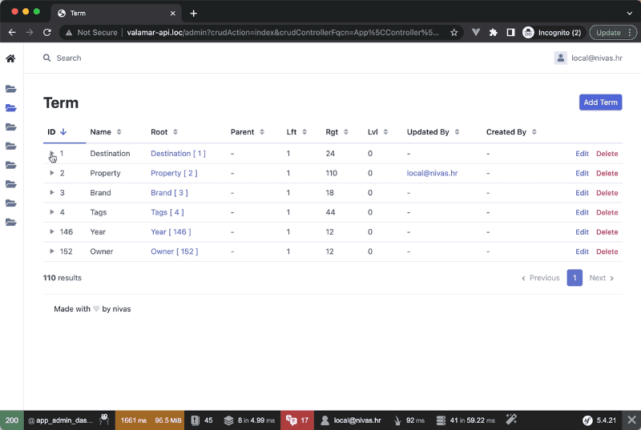

# easyadmin-tree-list-bundle

EasyAdmin 4.x / Symfony 6.4+ & 7.x compatible bundle which overrides the default EasyAdmin index (list) template and adds a nested tree view on list for entities that use the [Gedmo Tree extension](https://github.com/doctrine-extensions/DoctrineExtensions).



## Version compatibility

| Bundle version | EasyAdmin | Symfony | PHP |
|---|---|---|---|
| `v2.x` | 4.x | 6.4+ / 7.x | >= 8.1 |
| `v1.0.0` | 3.x | 5.x | >= 7.2 |

In order to achieve the nested tree view, your entity must implement a Gedmo nested tree with the following properties:

- `root` association
- `parent` association
- `lft` (left) property
- `rgt` (right) property
- `lvl` (level) property

Example of such an entity: https://github.com/doctrine-extensions/DoctrineExtensions/blob/main/doc/tree.md

Since v2, the template reads the tree structure directly from the entity's `root` and `parent` associations (rendered as `data-root-id` / `data-parent-id` row attributes via EasyAdmin 4's `entity_row_attributes` block hook). The `lft` property is still used for ordering the index query so rows arrive in tree order.

## Notable mentions and some history

On many Symfony 4 projects, we used `2lenet/EasyAdminPlusBundle`'s tree view feature. As we migrated projects to Symfony v5 / EasyAdmin v3 and later Symfony v7 / EasyAdmin v4 - we lacked this simple tree view feature and decided to make tree view work again.

History:

- [WandiParis/EasyAdminPlusBundle](https://github.com/WandiParis/EasyAdminPlusBundle) original bundle from which everything started
- [2lenet/EasyAdminPlusBundle](https://github.com/2lenet/EasyAdminPlusBundle) which forked `WandiParis/EasyAdminPlusBundle` and added tree view and made it work for EasyAdmin v1
- [uknight/EasyAdminPlusBundle](https://github.com/uknight/EasyAdminPlusBundle) which forked `2lenet/EasyAdminPlusBundle` and made it work for EasyAdmin v2

To achieve tree functionality in templates, the really old [jQuery treetable Plugin 3.2.0](http://ludo.cubicphuse.nl/jquery-treetable) was used from Ludo van den Boom, just like in the `2lenet/EasyAdminPlusBundle` bundle. Will check out how to replace it with something recent.

## Installation

```
composer require nivas/easyadmin-tree-list-bundle
```

after installation your `bundles.php` will contain the new bundle:

```
<?php

return [
...
    Nivas\Bundle\EasyAdminTreeListBundle\EasyAdminTreeListBundle::class => ['all' => true],
];
```

## Configuration

As mentioned previously, your entity must implement Gedmo Tree.

Your EasyAdmin CRUD controller should override:
- `configureResponseParameters` - used to enable tree rendering for the entity's index template
- `createIndexQueryBuilder` - used to change sorting order needed to make a tree list
- `configureActions` - (optional) used to remove batch actions in front of the tree navigation arrow

Example of `src/Controller/Admin/TermCrudController.php`:

```
<?php

namespace App\Controller\Admin;

use App\Entity\Term;
use EasyCorp\Bundle\EasyAdminBundle\Controller\AbstractCrudController;
use EasyCorp\Bundle\EasyAdminBundle\Config\KeyValueStore;

// for the custom order query
use EasyCorp\Bundle\EasyAdminBundle\Dto\EntityDto;
use EasyCorp\Bundle\EasyAdminBundle\Dto\SearchDto;
use EasyCorp\Bundle\EasyAdminBundle\Orm\EntityRepository;
use EasyCorp\Bundle\EasyAdminBundle\Collection\FieldCollection;
use EasyCorp\Bundle\EasyAdminBundle\Collection\FilterCollection;
use Doctrine\ORM\QueryBuilder;

// for disabling batch actions
use EasyCorp\Bundle\EasyAdminBundle\Config\Actions;
use EasyCorp\Bundle\EasyAdminBundle\Config\Action;

class TermCrudController extends AbstractCrudController
{
    private EntityRepository $entityRepository;

    public function __construct(EntityRepository $entityRepository)
    {
        $this->entityRepository = $entityRepository;
    }

    public static function getEntityFqcn(): string
    {
        return Term::class;
    }

    // REQUIRED - enables the tree template override, replacement for the old yaml config "tree: true"
    public function configureResponseParameters(KeyValueStore $responseParameters): KeyValueStore
    {
        $responseParameters->set('tree', true);
        return $responseParameters;
    }

    // REQUIRED - without this the list is not sorted in tree order and the tree is not assembled correctly
    public function createIndexQueryBuilder(SearchDto $searchDto, EntityDto $entityDto, FieldCollection $fields, FilterCollection $filters): QueryBuilder
    {
        $qb = $this->entityRepository->createQueryBuilder($searchDto, $entityDto, $fields, $filters);
        $qb->resetDQLPart('orderBy');
        $qb->addOrderBy($qb->getRootAlias().'.root', 'ASC');
        $qb->addOrderBy($qb->getRootAlias().'.lft', 'ASC');
        return $qb;
    }

    // not needed, the tree list just looks better without batch actions
    public function configureActions(Actions $actions): Actions
    {
        return $actions
            ->disable(Action::BATCH_DELETE);
    }

  ...

}
```

## v1 to v2 migration

v2 targets EasyAdmin 4 only (use `v1.0.0` for EasyAdmin 3). Notable changes:

- The index template no longer copies the whole EasyAdmin template - it extends `@!EasyAdmin/crud/index.html.twig` and only overrides the `entity_row_attributes` and `body_javascript` blocks, so it survives EasyAdmin template changes much better.
- Parent/child relations are no longer reconstructed in Twig from `lft`/`rgt`/`lvl` values - each row gets `data-root-id`/`data-parent-id` directly from the entity's `root`/`parent` associations.
- Filtered or searched result sets no longer break the view: rows whose parent is not present in the current result set drop their `data-parent-id` and are shown as top-level rows instead of being hidden by jquery.treetable.

No configuration changes are needed in your CRUD controllers besides the EasyAdmin 4 `EntityRepository` constructor injection shown above (the EasyAdmin 3 `$this->get(EntityRepository::class)` container access was removed in EasyAdmin 4).
